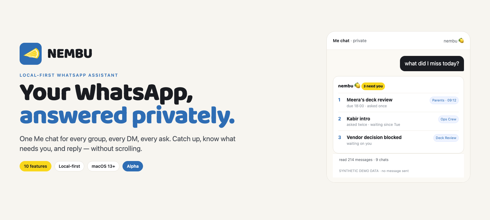
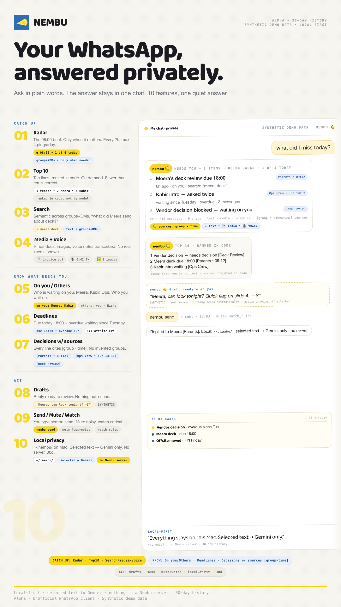
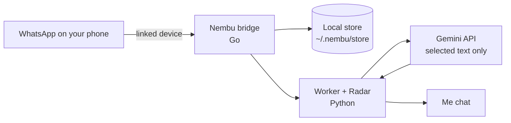

<div align="center">
  
</div>

<h1 align="center">Your WhatsApp, answered privately. 🍋</h1>

<p align="center">
  Nembu is a local-first WhatsApp assistant. It reads your groups and DMs and answers in your <b>Me chat</b> — so you can catch up, see what needs you, and reply without scrolling.
</p>

<p align="center">
  
  
  
  
  
</p>

<p align="center">
  <a href="#install"><b>Install</b></a> ·
  <a href="#the-10-features">Features</a> ·
  <a href="#how-it-works">How it works</a> ·
  <a href="#privacy-by-design">Privacy</a> ·
  <a href="#commands">Commands</a>
</p>

---

## The 30-second version

- **Ask in plain words.** “What did I miss today?” “What’s pending in Kitchen?” “Summarise my threads with Meera.” No slash commands, no new app.
- **Nembu watches for you.** Radar scans every 2 hours, 08:00–20:00 IST. The 08:00 scan is your morning brief. It only pings when something actually needs you — max 4 pings a day.
- **You press send.** Nembu prepares drafts for DMs and groups. It never sends automatically. A draft is only sent when you type `send`.

No new app. No bot in your groups. One quiet chat.

## What you can ask

```text
what did I miss today?
what's pending in Design Crew?
summarise my open threads with Meera
top 10
what should I respond to today?
send
mute Ops Crew 7d
watch Parents
```

## The 10 features

| Catch up | Know what needs you | Act |
|---|---|---|
| **Radar** — the 08:00 brief, every 2 hours, only when it matters | **On you / Others** — who is waiting on you, and what you are waiting on | **Drafts** — replies ready to review; nothing auto-sends |
| **Top 10** — today’s digest on demand, ranked in code | **Deadlines** — due today, overdue, “waiting since” | **Send** — you type `send`; the bridge sends the draft |
| **Search** — semantic search across groups and DMs | **Decisions with sources** — every line cites group + time; no invented groups | **Mute / Watch** — quiet noisy chats, watch the critical ones |
| **Media + voice** — finds docs, images and voice notes, transcribed | **Group names** — real names, not `DM 4052` | **Local privacy** — session + history on your Mac; no Nembu server |

<div align="center">
  
  <br>
  <sub>Launch poster · 10 features · <a href="assets/nembu-launch-poster.png">open full size</a></sub>
</div>

## How it works



- The **bridge** is a Go WhatsApp client that keeps your session and history local.
- The **worker** runs Radar, Q&A, drafts and the Me-chat replies.
- Only the **selected message text** needed to answer goes to Gemini. There is no Nembu server and no telemetry.
- The send path is loopback-only (`127.0.0.1`) and token-gated.

## Privacy by design

| What | Where it lives |
|---|---|
| WhatsApp session + history | `~/.nembu/store/` on your Mac |
| Gemini API key | `~/.nembu/.env`, mode `0600` |
| Sent to Gemini | Selected message text only |
| Nembu server | None |
| Telemetry | None |
| Retention | Last **30 days**; older messages, media and engine state are pruned |
| Send path | Loopback-only, token-gated; drafts never send automatically |

> Nembu is not affiliated with WhatsApp, Meta. It uses the unofficial `whatsmeow` client.

## Install

Paste this into Terminal on a clean Mac. Nothing needs to be installed first.

```bash
curl -fsSL https://raw.githubusercontent.com/sameer-hoda/Nembu-Alpha-Tester/main/install.sh | bash
```

The installer downloads the latest release and a private Python into `~/.nembu`, then opens Nembu. Re-run the same line to update; your messages and key are kept.

**Already on the old build?** Nembu migrates `~/.mosaic` to `~/.nembu` with a timestamped backup. `~/.mosaic` is never deleted. The old `mosaic` command still works as a deprecated wrapper.

### What it installs

| Path | What it is |
|---|---|
| `~/.nembu/app/` | Bridge binary + Python runtime scripts (replaced on update) |
| `~/.nembu/python/` | Bundled CPython 3.12 (nothing else to install) |
| `~/.nembu/store/` | WhatsApp session, messages, engine state (never overwritten) |
| `~/.nembu/.env` | Your Gemini key, mode `0600` (never overwritten) |
| `~/.nembu/bin/nembu` | The launcher |

### First run

1. Paste your **Gemini API key** — it is validated and saved to `~/.nembu/.env` only when it works.
2. Scan the **WhatsApp QR** in Terminal: Settings → Linked devices → Link a device.
3. Wait for sync (last 30 days), then say hello in your **Me chat**.

**Requirements:** macOS 13+ (Apple Silicon; Intel best-effort), a Gemini API key, and a WhatsApp account. Linux is community/untested. Use a secondary number if you can — it is an unofficial client.

## Commands

| Command | What it does |
|---|---|
| `nembu` | Open the TUI; starts the service if needed |
| `nembu status` | One-shot status |
| `nembu logs` | Follow the bridge log |
| `nembu stop` / `nembu start` | Stop / start the bridge and worker |
| `nembu update` | Download and install the newest release |
| `nembu uninstall` | Remove the app; asks before deleting messages/key |

Legacy: `mosaic status` → `nembu status` with a deprecation warning.

## Repo layout

```text
bridge/          Go WhatsApp bridge + TUI
*.py             Worker, Q&A, Radar, Me chat
assets/brand/    Nembu logo, mark, Baloo 2
assets/          Hero + launch poster
scripts/         QA, onboarding and preflight scripts
tests/           Python tests (migration, onboarding, Q&A)
docs/            QA cases and design docs
```

## Alpha warnings

- **Unofficial WhatsApp client.** Account restriction is possible. Use a number you are comfortable testing with.
- **One worker only.** Do not run two copies against the same store.
- **First sync can take a few minutes** depending on history size.
- **30-day retention** is intentional; export anything you need to keep.

## Docs

- [QA test cases](docs/qa-test-cases.md)
- [Onboarding E2E](docs/superagent/onboarding-e2e.md)
- [Superagent loop](docs/superagent/README.md)

## License

MIT. See [LICENSE](LICENSE).

---

<p align="center">
  <b>If Nembu saves you a scroll, star the repo. 🍋</b>
</p>
